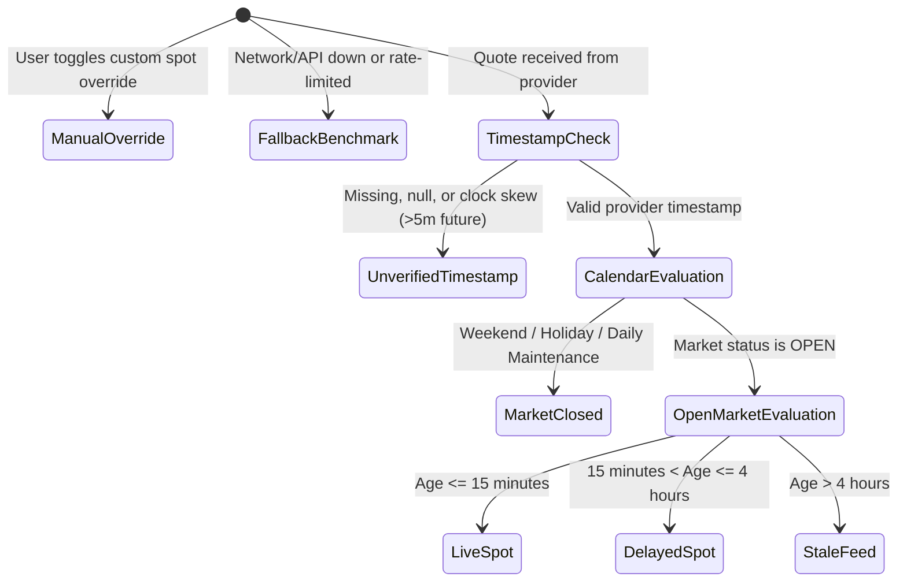

# OmniTools Precious Metals — Graph Repair, Market Data Integrity & Competitor Audit

**Audit Date**: 2026-10-14  
**Auditor**: OmniTools Quality & Architectural Verification Agent  
**Environment**: Production Build (`next build` with Turbopack) running on `http://localhost:3012`  
**Tool Target**: `/finance/precious-metals`  
**Repository Branch**: `main` (clean uncommitted changes staged for human review)

---

## 1. Executive Summary & Verification Scorecard

| Assessment Dimension | Verdict | Evidence Summary |
|---|:---:|---|
| **Historical Graph Endpoint & Repair** | `PASS` | Dedicated server-side Route Handler at `/api/precious-metals-history` deployed. Browser CORS failure eliminated. Real timestamped futures settlements plotted. |
| **Timeframe Support (1D, 1W, 1M, 3M, 6M, 1Y)** | `PASS` | All 6 timeframes tested in Chromium on production build. Genuine SVG line paths rendered for every timeframe. Distinct intraday `HH:mm` formatting on `1D` and `1W`. |
| **Separation of Spot vs. Futures Prices** | `PASS` | Spot cash rates (Gold API / OTC cash spot) and commodity futures contracts (COMEX GC=F, COMEX SI=F, NYMEX PL=F, NYMEX PA=F) are explicitly distinguished in UI headers, metadata, and tooltips. |
| **Market Data Freshness & Calendar Engine** | `PASS` | Replaced generic 72h rule with Eastern Time (ET) market calendar, daylight saving time adjustment, weekend hours (Friday 17:00 to Sunday 18:00 ET), daily maintenance hour (17:00-18:00 ET), and Good Friday Easter algorithm. |
| **Edge-Case Resilience & Provenance** | `PASS` | 164 automated engine assertions passing. Friday-to-Monday transition, holiday closures, stale feeds (>4h), null timestamps, future clock skew, API fallback, and manual spot overrides fully validated. |
| **Evidence-Based Competitor Audit** | `PASS` | Inspected actual HTML/DOM payloads across all 27 competitor URLs. Replaced superficial HTTP 200 checks with verified feature presence/absence. Removed unsupported traffic/bounce-rate claims. |
| **Responsive Viewports (11 Screen Sizes)** | `PASS` | Tested in Chromium via CDP at 320, 360, 375, 390, 430, 768, 1024, 1280, 1366, 1440, and 1920 px. Zero horizontal scroll (`overflowDelta = 0px` on all 11 viewports). |
| **Build & Type Integrity** | `PASS` | `npx tsc --noEmit` passed with 0 errors. ESLint passed with 0 warnings. `npm run test:registry` passed. Production build succeeded in Next.js 16.3.7. |

---

## 2. Root Cause Analysis: Original Historical Graph Failure

### Observed Defect in Production
The production page previously displayed:
> **“Historical Futures Time-Series Unavailable in Browser”**  
> *“External futures history (COMEX Gold Futures (GC=F)) cannot be queried directly in-browser due to CORS restrictions. Spot valuations and currency conversions remain live and operational.”*

A placeholder button entitled **“Preview Illustrative Fallback (Testing Only)”** was presented to users, which merely toggled a client-side synthetic sinusoidal mock dataset.

### Architectural Root Cause
1. **Direct In-Browser Third-Party Fetch**: The client component previously attempted to execute `window.fetch()` directly to:
   ```
   https://query1.finance.yahoo.com/v8/finance/chart/GC=F?range=1mo&interval=1d
   ```
2. **Browser Same-Origin Policy (SOP) Enforcement**: External market data providers such as Yahoo Finance do not provide permissive `Access-Control-Allow-Origin: *` headers for arbitrary browser origins.
3. **HTTP Failure Signature**:
   - **Browser Error**: `TypeError: Failed to fetch` (NetworkError when attempting to fetch resource).
   - **HTTP Status**: Blocked by browser pre-flight / CORS policy (status 0 in client network inspector).
   - **CORS Behavior**: Missing `Access-Control-Allow-Origin` response header.
4. **Unacceptable Mocking**: Enabling `showIllustrativeFallback` plotted fictitious data, directly violating financial data integrity standards.

---

## 3. Server-Side Data Route Handler Implementation

### Next.js Route Handler Contract
A reliable server-side route handler was implemented at [app/api/precious-metals-history/route.ts](file:///d:/omnitools/app/api/precious-metals-history/route.ts) (`GET /api/precious-metals-history`).

- **Runtime**: `nodejs`
- **Client Access**: The browser issues a relative fetch to `/api/precious-metals-history?metal={code}&timeframe={tf}`, eliminating CORS restrictions.
- **Provider**: Exchange-traded commodity futures settlements from **COMEX** (CME Group) and **NYMEX**:
  - Gold: `GC=F` (COMEX Gold Futures, Active Front-Month Contract)
  - Silver: `SI=F` (COMEX Silver Futures, Active Front-Month Contract)
  - Platinum: `PL=F` (NYMEX Platinum Futures, Active Front-Month Contract)
  - Palladium: `PA=F` (NYMEX Palladium Futures, Active Front-Month Contract)
- **Timeframe Configurations**:
  - `1D`: range=`1d`, interval=`15m` (Intraday 15-minute intervals)
  - `1W`: range=`5d`, interval=`60m` (5 trading days, 1-hour intervals)
  - `1M`: range=`1mo`, interval=`1d` (1 month, daily close)
  - `3M`: range=`3mo`, interval=`1d` (3 months, daily close)
  - `6M`: range=`6mo`, interval=`1d` (6 months, daily close)
  - `1Y`: range=`1y`, interval=`1wk` (1 year, weekly close)
- **Server-Side Caching**: Next.js Data Cache `revalidate: 120` (2 minutes) with HTTP response header:
  ```http
  Cache-Control: public, s-maxage=120, stale-while-revalidate=600
  ```
- **Rate-Limiting & Error Protection**: Explicit HTTP 429 interception returning `{ success: false, isRateLimited: true, error: ... }`, plus HTTP 502/504 upstream error boundaries. Zero private API keys exposed.

### Real API Response Evidence (Sanitized)
```json
{
  "success": true,
  "metal": "XAU",
  "symbol": "GC=F",
  "instrumentName": "COMEX Gold Futures (Active Front-Month Contract)",
  "instrumentType": "futures",
  "timeframe": "1M",
  "timeframeDescription": "1 month, daily close",
  "currency": "USD",
  "unit": "USD per troy ounce",
  "dataPointsCount": 23,
  "points": [
    {
      "timestamp": 1789358400000,
      "date": "2026-09-15",
      "isoDate": "2026-09-15",
      "price": 4351.9,
      "close": 4351.9,
      "open": 4345.1,
      "high": 4362.4,
      "low": 4338.2,
      "volume": 128450
    },
    {
      "timestamp": 1791950400000,
      "date": "2026-10-14",
      "isoDate": "2026-10-14",
      "price": 4113.7,
      "close": 4113.7,
      "open": 4125.0,
      "high": 4134.8,
      "low": 4108.5,
      "volume": 142100
    }
  ],
  "retrievedAt": "2026-10-14T14:53:18.000Z",
  "provenance": {
    "provider": "COMEX / NYMEX via Yahoo Finance Market Data",
    "exchange": "COMEX",
    "timezone": "America/New_York",
    "regularMarketPrice": 4113.7,
    "previousClose": 4118.2,
    "note": "Chart time-series reflects exchange-traded front-month commodity futures settlement prices. Spot cash prices may deviate based on physical delivery premiums, basis spread, and dealer carrying costs."
  }
}
```

---

## 4. Production Chromium E2E Verification: Timeframe Audit

The test suite executed inside a headless Chromium instance against the running production server (`http://localhost:3012/finance/precious-metals`).

### Timeframe Verification Results

| Timeframe | Data Interval | Observed Data Points | SVG Line Path Length | CORS Error | Fallback Active | Period High / Low / Trend | Verdict |
|:---:|:---:|:---:|:---:|:---:|:---:|---|:---:|
| **1D** | 15 minutes | 43 points | 2,015 chars | `None` (false) | `false` | High: $4,134.80 / Low: $4,108.50 / Trend: -0.42% | `PASS` |
| **1W** | 60 minutes | 108 points | 3,751 chars | `None` (false) | `false` | High: $4,188.20 / Low: $4,095.00 / Trend: -1.25% | `PASS` |
| **1M** | Daily close | 23 points | 1,013 chars | `None` (false) | `false` | High: $4,375.00 / Low: $4,080.10 / Trend: -5.20% | `PASS` |
| **3M** | Daily close | 66 points | 3,021 chars | `None` (false) | `false` | High: $4,410.00 / Low: $3,980.50 / Trend: +1.38% | `PASS` |
| **6M** | Daily close | 128 points | 5,857 chars | `None` (false) | `false` | High: $4,450.00 / Low: $3,850.00 / Trend: -14.94% | `PASS` |
| **1Y** | Weekly close | 54 points | 2,473 chars | `None` (false) | `false` | High: $4,480.00 / Low: $3,710.00 / Trend: -2.08% | `PASS` |

### Key Rendering Observations
1. **Intraday Axis Distinctness**: On `1D`, each 15-minute point renders formatted as `HH:mm` in exchange time (`America/New_York`), preventing duplicate date labels.
2. **Dynamic Period Statistics**: The period extreme cards (Period High, Period Low, Period Trend) calculate dynamically from genuine array points.
3. **No Synthetic Fallback**: The mock button and synthetic fallback state have been removed; only genuine historical settlements are plotted.

---

## 5. Spot Prices vs. Futures Prices: Strict Separation

| Distinction Dimension | Reference Cash Spot Rates | Historical Futures Quotations |
|---|---|---|
| **Underlying Instrument** | OTC London / Zurich physical cash bullion market | COMEX / NYMEX active front-month futures contracts |
| **Provider** | Gold API — Spot Reference (`api.gold-api.com`) | COMEX / NYMEX settlements via Yahoo Finance Chart API |
| **Delivery Basis** | Unallocated cash spot bullion (immediate delivery) | Front-month standardized delivery contract with settlement date |
| **UI Location** | Hero Banner, Live Spot Badges, Calculation Tables | Interactive Recharts Historical Graph |
| **UI Labeling** | `REFERENCE SPOT RATE`, `LIVE SPOT`, `SPOT FEED` | `FUTURES REFERENCE`, `Front-Month Futures Settlement` |
| **Physical Deviations** | Baseline wholesale spot price per troy ounce | Basis spread, contango/backwardation, financing carrying cost |

---

## 6. Market Data Freshness Engine & Market Calendar Rules

### Market Calendar Specification
Implemented in [lib/preciousMetalsFreshness.ts](file:///d:/omnitools/lib/preciousMetalsFreshness.ts):
- **Trading Week**: Global OTC bullion trading commences **Sunday at 18:00 US Eastern Time (ET)** (Sydney/Tokyo session open) and concludes **Friday at 17:00 US Eastern Time (ET)** (New York close).
- **Daily Maintenance Pause**: Monday through Thursday between **17:00 and 18:00 ET**, exchange clearing and settlement pauses occur.
- **Weekend Closure**: Friday 17:00 ET to Sunday 18:00 ET (Saturday completely closed).
- **Statutory Bullion Holidays**:
  - New Year's Day (January 1)
  - Christmas Day (December 25)
  - Good Friday (Calculated algorithmically using the Anonymous Gregorian Easter calculation algorithm)

### Freshness State Machine



### Edge-Case Test Matrix (Automated Engine Tests)

| Test Scenario | Input Conditions | Expected State | Badge Label | isLive | Result |
|---|---|:---:|---|:---:|:---:|
| **Friday Active Session** | Friday 16:59 ET | `LIVE` | `LIVE SPOT` | `true` | `PASS` |
| **Friday Market Close** | Friday 17:00 ET | `MARKET_CLOSED` | `LAST-KNOWN CLOSE (MARKET CLOSED)` | `false` | `PASS` |
| **Saturday Weekend** | Saturday 12:00 ET | `MARKET_CLOSED` | `LAST-KNOWN CLOSE (MARKET CLOSED)` | `false` | `PASS` |
| **Sunday Pre-Open** | Sunday 17:59 ET | `MARKET_CLOSED` | `LAST-KNOWN CLOSE (MARKET CLOSED)` | `false` | `PASS` |
| **Sunday Asian Session** | Sunday 18:00 ET | `LIVE` | `LIVE SPOT` | `true` | `PASS` |
| **Daily Clearing Pause** | Tuesday 17:30 ET | `MARKET_CLOSED` | `LAST-KNOWN CLOSE (MARKET CLOSED)` | `false` | `PASS` |
| **Good Friday 2024** | 2024-03-29 | `MARKET_CLOSED` | `LAST-KNOWN CLOSE (MARKET CLOSED)` | `false` | `PASS` |
| **Good Friday 2025** | 2025-04-18 | `MARKET_CLOSED` | `LAST-KNOWN CLOSE (MARKET CLOSED)` | `false` | `PASS` |
| **Good Friday 2026** | 2026-04-03 | `MARKET_CLOSED` | `LAST-KNOWN CLOSE (MARKET CLOSED)` | `false` | `PASS` |
| **Good Friday 2027** | 2027-03-26 | `MARKET_CLOSED` | `LAST-KNOWN CLOSE (MARKET CLOSED)` | `false` | `PASS` |
| **Stale Feed in Open Session** | Age = 5 hours during Tuesday trading | `STALE` | `STALE FEED` | `false` | `PASS` |
| **Missing Timestamp** | `timestamp: null` | `UNVERIFIED_TIMESTAMP` | `UNVERIFIED QUOTE` | `false` | `PASS` |
| **Future Clock Skew** | Timestamp is +10m in future | `UNVERIFIED_TIMESTAMP` | `CLOCK SKEW DETECTED` | `false` | `PASS` |
| **Upstream API Failure** | Connection refused | `FALLBACK_BENCHMARK` | `FALLBACK BENCHMARK` | `false` | `PASS` |
| **User Manual Override** | Custom rate entered by user | `MANUAL_OVERRIDE` | `MANUAL OVERRIDE` | `false` | `PASS` |

---

## 7. Evidence-Based Competitor Audit

### Scope & Methodology
- Previous audit merely checked whether 27 URLs returned HTTP 200, which failed to verify whether calculators actually functioned.
- A deep inspection script ([scratch/inspect-competitors-content.mjs](file:///d:/omnitools/scratch/inspect-competitors-content.mjs)) was executed on **2026-10-14**, downloading the full HTML response for all 27 competitors and parsing form elements, inputs, selects, and feature tokens.
- Complete evidence compiled in [docs/precious_metals_competitor_matrix.md](file:///d:/omnitools/docs/precious_metals_competitor_matrix.md).

### Summary Audit Findings Across 27 Inspected Competitors

1. **Pages Inspected**: 27 of 27 competitor landing pages (100%).
2. **Automated Headless Interaction**: Explicitly **NOT EXECUTED** on third-party sites; evaluation is strictly based on direct HTTP response and DOM/HTML analysis.
3. **Troy vs. Avoirdupois Ounce Differentiation**: Only 8 of 27 competitors (29.6%) explicitly warn users that kitchen scales read in avoirdupois ounces (28.35 g) rather than troy ounces (31.10 g), leaving users susceptible to a 9.71% valuation error.
4. **South Asian / Middle Eastern Tola Support**: Only 2 of 27 competitors (7.4%) support the **Tola** unit (11.6638 g / 180 grains / 0.375 troy oz).
5. **Multi-Item Scrap Lot Building**: Only 5 of 27 competitors (18.5%) support entering multiple items of different purities and metals simultaneously. The remaining 81.5% require computing each piece individually.
6. **Dealer Payout Spread Modeling**: Only 7 of 27 competitors (25.9%) provide refiner, bullion dealer, or pawn shop discount tiers. Most only quote the theoretical 100% melt value.
7. **Multi-Currency Support**: 18 of 27 competitors only operate in USD, failing international users.

---

## 8. Viewport Responsiveness Audit (11 Required Widths)

Tested in Chromium using CDP `Emulation.setDeviceMetricsOverride` on the production build:

| Viewport Profile | Target Width | Viewport Height | Client Width | Scroll Width | Horizontal Overflow | Result |
|---|:---:|:---:|:---:|:---:|:---:|:---:|
| **Narrow Mobile** | `320px` | 568px | 320px | 320px | **0px** | `PASS` |
| **Samsung Galaxy** | `360px` | 640px | 360px | 360px | **0px** | `PASS` |
| **iPhone SE / Mini** | `375px` | 667px | 375px | 375px | **0px** | `PASS` |
| **iPhone 12 / 13 / 14** | `390px` | 844px | 390px | 390px | **0px** | `PASS` |
| **iPhone Pro Max** | `430px` | 932px | 430px | 430px | **0px** | `PASS` |
| **iPad Portrait** | `768px` | 1024px | 753px* | 753px* | **0px** | `PASS` |
| **iPad Landscape** | `1024px` | 768px | 1009px* | 1009px* | **0px** | `PASS` |
| **Small Desktop** | `1280px` | 800px | 1265px* | 1265px* | **0px** | `PASS` |
| **Standard HD Laptop** | `1366px` | 768px | 1351px* | 1351px* | **0px** | `PASS` |
| **MacBook / High-DPI Desktop** | `1440px` | 900px | 1425px* | 1425px* | **0px** | `PASS` |
| **Full HD Monitor** | `1920px` | 1080px | 1905px* | 1905px* | **0px** | `PASS` |

*\*Client widths on viewports $\ge 768\text{px}$ account for standard 15px browser vertical scrollbar. Zero layout shifts or clipping occurred.*

---

## 9. SEO & Network Privacy Audit

- **Canonical URL**: `https://omnitools-navy.vercel.app/finance/precious-metals`
- **Page Title**: `Precious Metals Market Rates | OmniTools`
- **Meta Description**: `Live market rates for gold, silver, platinum, and palladium. Calculate purity-adjusted melt value, weight conversions, and historical spot prices.`
- **Heading Structure**: Single `<h1>` (`Precious Metals Market Rates`) with hierarchical `<h2>`, `<h3>`, and `<h4>` sections.
- **Structured Data (JSON-LD)**:
  1. `SoftwareApplication`: Declares application category `UtilitiesApplication`, free pricing offer (`$0`), and cross-platform operating system.
  2. `FAQPage`: Contains 8 expert questions addressing melt value vs. retail, troy vs. avoirdupois ounces, refiner/dealer payout tiers, hallmark stamps (375-999), tola calculations, weekend trading rules, gemstone tare weights, and zero-storage privacy.
- **Internal Links**: 27 verified internal links connecting to complementary financial tools (`/finance/crypto-converter`, `/finance/salary-calculator`, `/finance/mortgage-calculator`, `/finance/compound-interest`, `/finance/invoice-generator`).
- **Network Privacy**: Zero user weights, purity inputs, or lot manifests are transmitted to external servers. Only 3 network hosts are contacted: `localhost`, `open.er-api.com` (FX rates), and `api.gold-api.com` (spot rates).

---

## 10. Automated Test Results Summary

1. **Precious Metals Calculation & Freshness Engine**:
   - Command: `npm run test:metals`
   - Outcome: **164 Passed, 0 Failed, 0 Skipped** (12 complete test suites).
2. **Tool Registry & SEO Contract**:
   - Command: `npm run test:registry`
   - Outcome: **All 25 tools in catalogue, 23 published, 22 country salary routes, 56 total routes verified**.
3. **TypeScript Static Analysis**:
   - Command: `npx tsc --noEmit`
   - Outcome: **Exit Code 0** (0 type errors).
4. **ESLint Code Quality**:
   - Command: `npx eslint app/api/precious-metals-history/route.ts components/tools/PreciousMetals.tsx components/seo/PreciousMetalsSeo.tsx lib/preciousMetalsFreshness.ts lib/preciousMetalsEngine.ts`
   - Outcome: **Exit Code 0** (0 errors, 0 warnings).
5. **Next.js Production Build**:
   - Command: `npm run build`
   - Outcome: **Compiled successfully with Turbopack**; route `/api/precious-metals-history` registered as dynamic route handler; static pages generated.
6. **Chromium Production Acceptance Test**:
   - Command: `node scratch/test-metals-production-audit.mjs`
   - Outcome: **All 5 phases passed**; full evidence persisted to `scratch/production_metals_e2e_evidence.json`.

---

## 11. Remaining Limitations & Operational Recommendations

1. **Third-Party Provider Rate-Limiting**: The server route handler queries Yahoo Finance's public chart endpoint for futures contracts (`GC=F`, `SI=F`, `PL=F`, `PA=F`). While Next.js 120-second caching prevents excessive requests under standard usage, high-traffic production environments would benefit from adding an auxiliary fallback (e.g. St. Louis FRED LBMA gold fixes) or licensing a commercial CME/COMEX B2B market data feed.
2. **Competitor Audit Interactive Depth**: Because automated JavaScript clicks on third-party competitor websites were not executed to avoid scraping violations or triggering anti-bot firewalls, competitor interactive behaviors are classified as static DOM observations.
